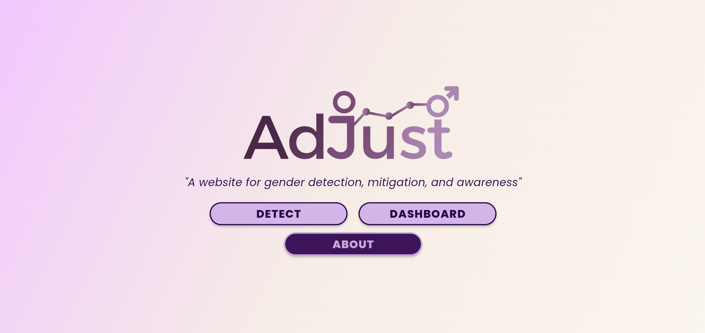
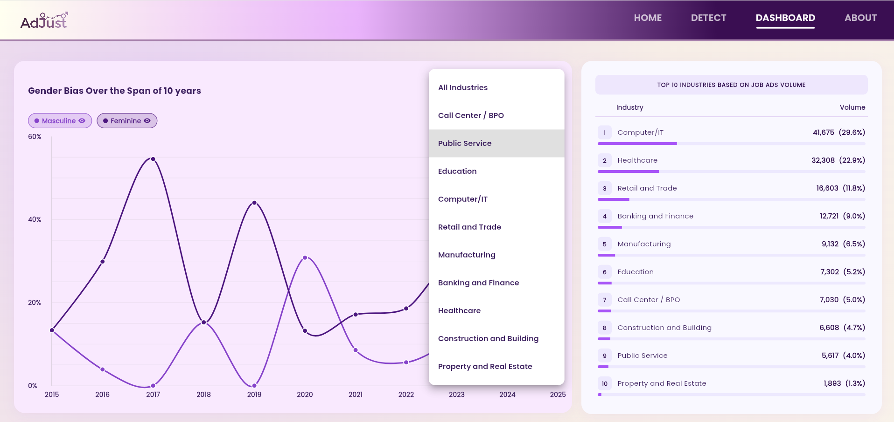
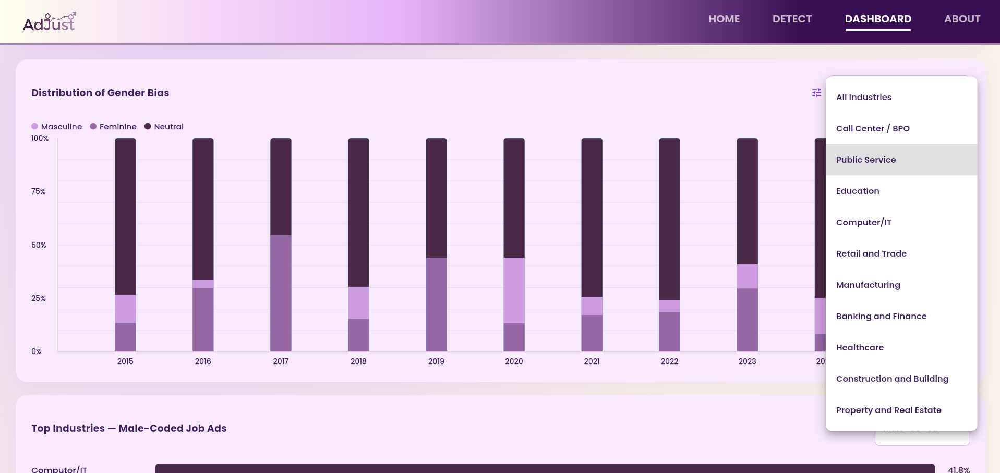
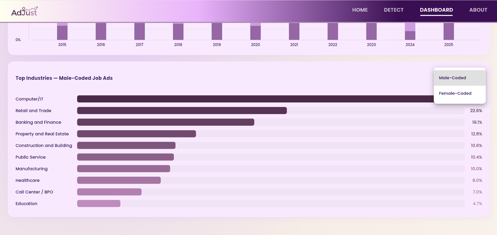

# AdJust

> A website for gender bias detection, mitigation, and awareness in job advertisements, with a 10-year trend dashboard (2015-2025).

## Overview
Job ads often use wording that quietly signals who should apply. AdJust is our undergraduate thesis project (Computer Science, Bicol University). It classifies job ad text as masculine-biased, feminine-biased, or neutral, and tracks how that bias has shifted over a decade across industries.

## Key Features
- **Detect:** paste a job description and get its gender-bias classification. It also highlights the detected biased words or phrase and show option to replace them with their neutral counterpart. 
- **Dashboard:** interactive time-series of masculine, feminine, and neutral bias from 2015 to 2025.
- **Industry filter:** view trends for all industries or a single one (Computer/IT, Healthcare, Banking and Finance, Education, Public Service, and more).
- **Distribution view:** yearly stacked bars showing the share of masculine, feminine, and neutral ads.
- **Top industries:** ranking of industries by job ad volume, plus the top male-coded and female-coded industries.
- **Interactive charts:** hover tooltips with exact percentages per year, smooth line curves, and per-series show/hide toggles.
- **About:** background on the study and its goals.

## Screenshots
| Home | Trend over time |
|---|---|
|  |  |

| Yearly distribution | Male-/female-coded industries |
|---|---|
|  |  |

## Data and Method
- **140,889 job ads** from 2015-2025 across 10 industries, each labeled masculine-coded, feminine-coded, or neutral. A sample was labeled manually, then rule-based labeling was applied to the full dataset.
- Yearly bias proportions per industry were turned into time series.
- **Mann-Kendall trend test** (non-parametric, so no normality assumption) applied to 44 series: 4 overall and 40 at industry level (10 industries × masculine, feminine, neutral, and bias score). A lag-1 autocorrelation check found no significant autocorrelation, so no pre-whitening was needed. Results include Kendall's tau, p-value, and Sen's slope.

## Key Findings (presented in the dashboard)
- **Neutral dominates, but bias is still present:** 58.67% neutral, 22.42% masculine-coded, 18.91% feminine-coded.
- **Gendered language follows occupational stereotypes:** Computer/IT, Retail and Trade, and Banking and Finance lean masculine, while Healthcare and Education lean feminine.
- **No overall trend, but industry-level shifts:** the overall Mann-Kendall test found no significant trend (all p > 0.05). At industry level, 7 of 40 tests were significant:
  - Masculine-coded language is **increasing** in Call Center/BPO, Construction and Building, Manufacturing, and Property and Real Estate (p < 0.05).
  - Neutral postings are **decreasing** in Healthcare and Call Center/BPO.
  - Property and Real Estate has a significant upward bias score trend.
- **Data caveat:** the 2017 spike in masculine proportion (85.1%) comes from a small sample (1,422 ads) and is treated as an outlier, not a trend.

## Tech Stack
- **Frontend:** Flutter Web, Dart
- **Charts:** fl_chart (line, stacked bar, and ranking views)
- **Data:** pre-processed CSV time series loaded at runtime with the `csv` package
- **Analysis:** Mann-Kendall trend testing on the time series 

## Method
- Job ads from 2015-2025 across 10+ industries (140,000+ ads), each labeled masculine-biased, feminine-biased, or neutral. A sample was labeled manually, then rule-based labeling was applied to the full dataset.
- Yearly bias percentages per industry were turned into time series.
- A **Mann-Kendall trend test** was applied to each industry's series to check whether the increase or decrease in bias over time is statistically significant, reporting Kendall's tau, p-value, and Sen's slope.

## My Role
Designed and built the dashboard in Flutter Web: interactive charts, industry filters, series toggles, and the ranking views. Performed and integrated the Mann-Kendall trend results into the dashboard's data layer. 

## Highlights / Results
- Computer/IT (29.6%) and Healthcare (22.9%) account for the largest shares of the dataset.
- 83.2% of neutral-labeled ads still contain gender-coded words, and nearly half (49.62%) of them contain more masculine-coded than feminine-coded words, suggesting subtle masculine bias even in "neutral" postings.
- Masculine-coded ads are longer on average (314 words) than feminine-coded ones (245 words), a statistically significant difference (Mann-Whitney U, p < 0.05).

## Challenges and What I Learned
- Handling uneven yearly sample sizes (e.g., 1,422 ads in 2017) so outlier years don't get mistaken for trends.
- Choosing a non-parametric trend test (Mann-Kendall) for short, volatile yearly series, and checking autocorrelation first.
- Turning statistical results into interactive Flutter charts that a non-technical user can explore.

## Access
Source code is private (thesis project). Walkthrough or code access available on request: barbacena.jenny.borcel@gmail.com
